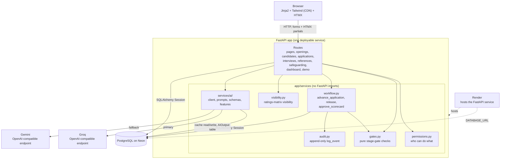

# Architecture

## Components

**Browser.** Server-rendered Jinja2 templates styled with Tailwind (play CDN); HTMX handles the
one place a full page reload would be disruptive -- the "Suggest evidence (AI)" panel on the
focused-interview rating form, which posts the in-progress notes textarea and swaps in a partial
without losing unsaved grades. Everything else is plain HTML forms and links; no client-side
framework or build step.

**Routes (`app/routers/`).** Thin FastAPI handlers: parse the request, check a permission, call a
service function, commit or roll back, redirect with a flash message. Business rules never live
here -- a route that needs to decide something always delegates to `app/services`.

**`permissions.py`.** Pure functions (`can_create_opening(user)`, `can_manage_scorecard(user,
opening)`, ...) answering "can this user do this." Consulted by routes (to enforce, returning 403
otherwise) and by templates (to hide the button). One predicate per capability from the spec;
nothing role-based is checked ad hoc anywhere else.

**`gates.py`.** Pure functions with no database access, one per forward stage transition in the
Who method (`sourced -> screening` through `decision -> offer`). Each returns a `GateResult`
(`allowed: bool`, `reasons: list[str]`) by reading an already-loaded `Application` and its
relationships. No side effects, so they're trivially unit-testable with plain constructed objects.

**`workflow.py`.** The only place state actually changes: `advance_application` (checks the move is
valid, runs the gate, applies it, audit-logs it, supports a chairman-only override), `release_interviewer`,
`approve_scorecard`, and `create_default_safeguarding_checks` (fires automatically on entering the
references stage).

**`audit.py`.** One function, `log_event`, used by every mutation above. Deliberately has no
update or delete -- the audit trail is append-only by construction, not by convention.

**`visibility.py`.** `can_view_ratings(user, interview)`: chairman/HR/the opening's hiring manager
always see the ratings matrix; an interviewer only sees others' ratings once they've submitted
their own.

**`services/ai/`.** `client.py` calls an OpenAI-compatible endpoint, trying Groq then Gemini, with
retry-then-fallback on rate limits/5xx and a validation-retry on malformed JSON; `call_llm_cached`
checks `AIOutput` (keyed by task + a hash of the normalised input + prompt version) before ever
calling out. `prompts.py` and `schemas.py` hold versioned prompts and the Pydantic schemas the
response must satisfy -- no schema has a grade, score, or rank field. `features.py` is the small
set of drafting features (scorecard draft, focused-interview questions, evidence mapping with a
quote-verification guard, a neutral decision summary), each gated on `AI_ENABLED` and audit-logged.

**PostgreSQL on Neon.** The single source of truth: all 14 tables (users, openings, scorecards and
items, candidates, applications, interviews, ratings, references, safeguarding checks, decisions,
sell plans, audit events, and cached AI outputs), reached over SSL via psycopg 3.

**Groq / Gemini.** External LLM providers, called only for the four AI drafting features, only
when `AI_ENABLED=true`, and never in the hot path of a stage-gate decision.

**Render.** Where the service would run in production (not deployed as part of this submission):
one free-tier web service, `alembic upgrade head` on every start, `/health` for Render's health
check.
